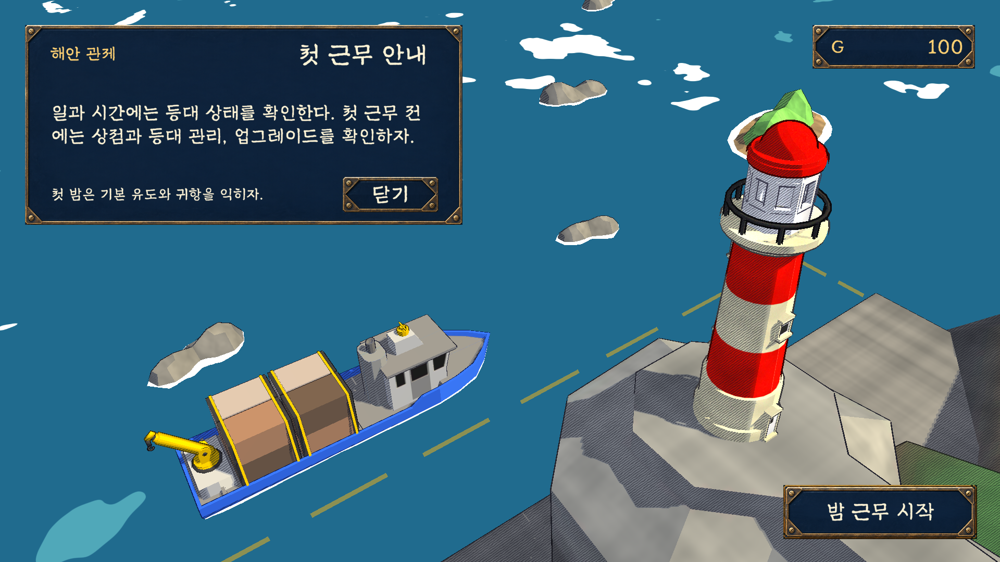
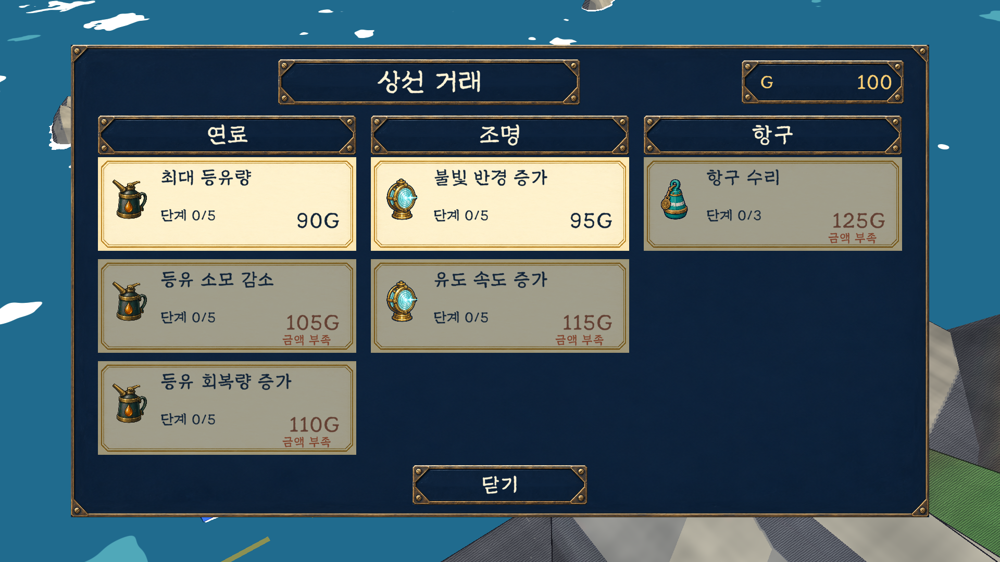
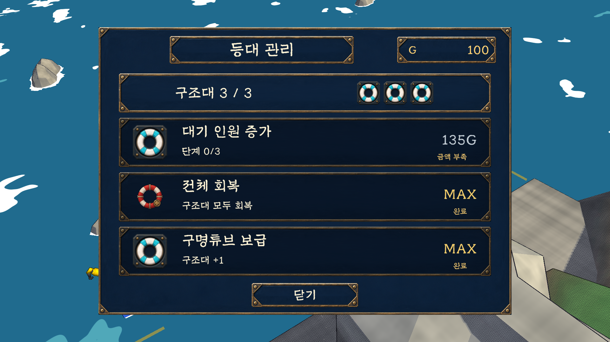
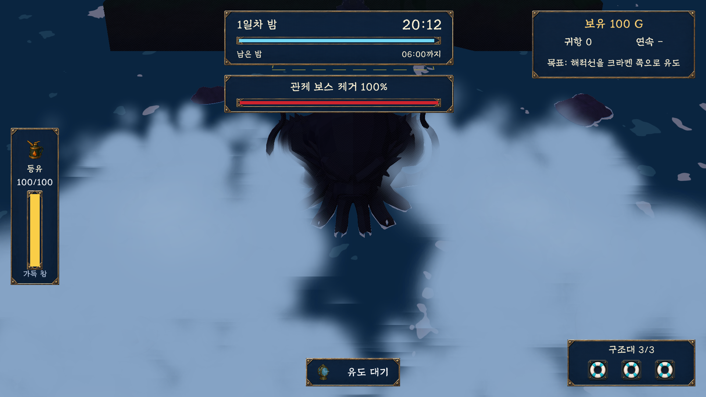

# 등대 · the LIGHTHOUSE

> 어두운 밤바다에서 빛으로 배를 안전한 항구까지 이끄는 포인트 앤 클릭 게임

플레이어는 등대지기가 되어 낮에는 다음 근무를 준비하고, 밤에는 등댓불로 배의 항로를 안내합니다. 제한된 등유와 구조대를 관리하면서 안개, 강풍, 해적선을 넘어 네 개의 섬을 지나가세요.

**[Windows 버전 다운로드](https://github.com/remerer/LightHouse-releases/releases/latest)** · **[게임 개요](GAME_OVERVIEW.md)** · **[문제 제보](https://github.com/remerer/LightHouse-releases/issues)**

| 항목 | 내용 |
| --- | --- |
| 장르 | 포인트 앤 클릭 · 선박 유도 · 자원 관리 |
| 플랫폼 | Windows 64비트 |
| 언어 | 한국어 |
| 현재 버전 | v1.1.0 |
| 제작 계기 | 크래프톤 정글 24시간 게임잼 |

## 다운로드와 실행

1. [최신 릴리즈](https://github.com/remerer/LightHouse-releases/releases/latest)에서 `LightHouse-v1.1.0-Windows-x64.zip`을 다운로드합니다.
2. ZIP 파일 전체를 압축 해제합니다.
3. 압축을 푼 폴더에서 `LightHouse.exe`를 실행합니다.

`LightHouse_Data` 폴더와 DLL은 실행 파일 옆에 함께 두세요. Unity Editor 설치는 필요하지 않습니다. 릴리즈에 함께 제공하는 `SHA256SUMS.txt`로 다운로드 파일을 확인할 수 있습니다.

## 게임 화면

<table>
  <tr>
    <td> <strong>낮 근무</strong> — 등대와 장비를 확인하고 다음 밤을 준비합니다.</td>
    <td> <strong>상선 거래</strong> — 귀항 보상으로 등유와 유도 장비를 강화합니다.</td>
  </tr>
  <tr>
    <td> <strong>등대 관리</strong> — 구조대 인원을 늘리고 잃은 구조 자원을 회복합니다.</td>
    <td> <strong>마지막 섬</strong> — 해적선을 유도해 크라켄과 맞섭니다.</td>
  </tr>
</table>

스크린샷은 v1.1.0의 Unity 씬을 렌더링한 게임 화면입니다.

## 어떻게 플레이하나요?

- **낮:** 상선 거래와 등대 관리에서 장비를 강화하고 구조대를 정비합니다.
- **밤:** 배 근처로 포인터를 옮기고 유도등을 켜서 항구까지 안내합니다. 유도 중에는 등유를 소비하며, 빛을 끄면 회복합니다.
- **귀항:** 배를 안전하게 들여보내면 보상을 얻습니다. 암초에 부딪히거나 바다 밖으로 이탈한 배는 구조대 출동 횟수를 소모합니다.
- **캠페인:** 네 개의 섬에서 안개, 강풍, 소용돌이와 해적선을 만나고 마지막 섬에서 크라켄과 대치합니다.

| 조작 | 행동 |
| --- | --- |
| 마우스 이동 | 빛의 위치와 유도 방향 지정 |
| 마우스 왼쪽 버튼을 누르고 있기 | 유도등 켜기 |
| Space를 누르고 있기 | 유도등 켜기 |
| 버튼 클릭 | 메뉴 선택, 거래, 강화, 밤 근무 시작 |

유도등을 켜면 범위 안에서 포인터에 가장 가까운 배 한 척을 선택하고, 누르고 있는 동안 그 배를 안내합니다. 다른 배를 선택하려면 유도등을 껐다가 다시 켜세요. 등유와 구조대 출동 횟수를 확인하며 여러 배의 항로를 차례로 정리해 보세요.

## 제작진

게임 내 크레딧: **박상민 · 박 강 · 소경현 · 장홍표**

개발 저장소 참여자:

- [@remerer](https://github.com/remerer)
- [@sangmin2ya](https://github.com/sangmin2ya)
- [@urbanmaid](https://github.com/urbanmaid)
- [@dev-diver](https://github.com/dev-diver)

## 이 저장소에 관하여

게임 소개, 스크린샷, 실행 빌드와 릴리즈 기록을 공개하는 배포 저장소입니다. 개발용 Unity 프로젝트와 원본 소스 코드는 별도의 비공개 저장소에서 관리합니다.

오류를 발견했다면 [Issues](https://github.com/remerer/LightHouse-releases/issues)에 버전, 발생 상황, 스크린샷을 남겨 주세요.
